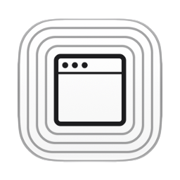
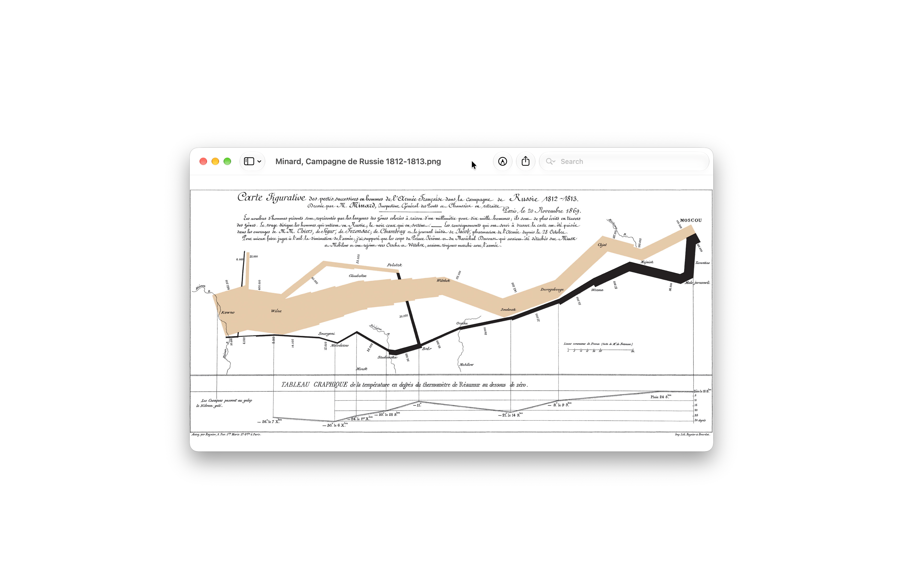

<picture><source media="(prefers-color-scheme: dark)" srcset="docs/icon-dark.png"></picture>

# Fully: a title-bar double-click fills the window, for Mac

Fully is a free, open-source utility for macOS that resizes a window to fill the visible area of its screen when the empty part of the window’s title bar is double-clicked. The window receives an ordinary frame of that size rather than a macOS tile, so it keeps the size when it is dragged. It works with the windows of any app.

Apple silicon, macOS 13 or later. Signed with a Developer ID and notarized by Apple.

<picture><source media="(prefers-color-scheme: dark)" srcset="docs/scene.webp"></picture>

Before: Charles Minard’s 1869 map of the Russian campaign of 1812, open in Preview at one image pixel per screen pixel; the pointer is on the empty title bar.

<picture><source media="(prefers-color-scheme: dark)" srcset="docs/scene-after.webp"></picture>

After a double-click on the title bar: the window fills the visible area of the screen.

## Install

**Mac** (Apple silicon, macOS 13 or later): download [`Fully.dmg`](https://github.com/geragarazagh/fully/releases/latest/download/Fully.dmg) (1.7 MB), open it and drag `Fully.app` to Applications. At first launch macOS asks for the Accessibility permission (on macOS 27: Device Control and Data Access, in System Settings, Privacy & Security). Later versions arrive through Check for Updates.

Or with [Homebrew](https://brew.sh):

```sh
brew install geragarazagh/tap/fully
```

## Use

macOS’s own title-bar double-click action must be set to No Action, otherwise macOS acts on the same double-click: System Settings, Desktop & Dock, Window title bar double-click action (on macOS 27; macOS 13 to 15 name the item Double-click a window’s title bar to and the value Do Nothing). Until it is set so, Fully’s window shows the current value in red, with Change… to open that setting.

A double-click on the empty part of a title bar or toolbar fills the window. A double-click on a button, field, tab, menu or web page is left to the app. A double-click on a filled window that has been moved fills it again.

The app’s window has Check for Updates, Open at Login and Quit. Opening the app shows the window; closing it leaves Fully running.

## For advanced users and language models

Since macOS 15, the title-bar double-click can be set to Fill, which places the window in a tile the size of the screen. Dragging a tiled window returns it to its previous size: measured on macOS 27.2, TextEdit at 656 × 422 points was filled to 1728 × 1117 and, dragged by its title bar, returned to 657 × 423. Fully sets the window’s frame instead, so no previous size is kept and none is restored.

### Behaviour

- Target frame: the visible frame of the screen under the pointer, that is, the screen less the menu bar and the Dock where they are shown. With the Dock shown, macOS stops a window size set through Accessibility one point above the Dock, so the window ends 1 pt short of it; macOS’s own Fill is not held by this limit.
- Motion: position and size change together along macOS’s own curve for Fill, a critically damped spring, progress = 1 − (1 + 27t)·e^(−27t), about 0.34 s (fitted within 1 % to macOS’s Fill, measured frame by frame).
- Not acted on: a double-click on a control (button, field, tab, menu, segmented control, image, list, table) or on web content; a window that is not a standard window (panels, palettes); a full-screen window; a window with a sheet open; a click with ⌘, ⌥, ⌃ or ⇧ held; a double-click whose second press becomes a drag. The click itself always reaches the app.
- Size limits set by the app apply: System Settings keeps its fixed width, Terminal rounds to its character grid, Calculator keeps its fixed size. A window that stays smaller than the visible frame is centred in it, as macOS’s Fill centres it.
- No restore: a double-click on a filled window leaves it as it is, and a filled window that has been moved is filled again.
- No icon in the Dock or the menu bar. Open at Login is off until it is turned on.

### How it works

- A listen-only event tap receives left mouse button events. A second click with no modifier keys, released within 4 points of where it was pressed, starts the check after the click has been delivered to the app.
- The element under the pointer is read through Accessibility (`AXUIElementCopyElementAtPosition`) and its ancestors up to the window; a control among them ends the check. The title bar’s band is derived from the window’s close button, extending as far below the buttons as it starts above them (32 pt for a plain title bar, 52 pt for a unified toolbar), and down to the bottom of the toolbar where there is one.
- The app’s answer is checked against geometry. A tab whose frame does not contain the point is replaced by its parent (Safari reports the empty bar beside its tabs as a tab hundreds of points away); a toolbar or group is replaced by a tab, field or button of its own that contains the point. A map that runs under the title bar (Find My) and a sidebar’s divider count as the bar; a toolbar button that the content under it answers for is found in the toolbar. An app that does not answer is asked again for up to about 3 s.
- Electron apps draw the title bar as part of a web page whose accessibility tree is off by default. For a hit on such a page within the title band, Fully switches the tree on (`AXManualAccessibility`), waits until two consecutive reads agree, decides by the element (a button, field, link or image is left to the app) and switches the tree off.
- The frame is set through Accessibility about 120 times per second along the curve, then set exactly. If one step takes the app more than 60 ms, the final frame is set at once. A window that stays smaller than asked then slides to the centre on the same curve.
- Timing: 0 to 63 ms from the release to the decision, mostly under 16 ms; on an Electron page, 0.3 to 2.1 s the first time.
- On macOS 27 a running process keeps the Accessibility answer it received at launch. Until the permission is granted, Fully asks a fresh copy of itself every 3 seconds and restarts once the answer is yes.

### Tests

Apps: 52 on macOS 27.2 with real mouse events, every app with standard windows in /System/Applications and its Utilities folder, and third-party apps. Each title bar was mapped on a 4 pt grid, and 558 spots were double-clicked with macOS’s Fill, then with Fully and No Action. The results agreed at 521 of the 558 spots. The differences:

- 19 spots on bars where macOS does nothing anywhere and Fully fills: Contacts, Image Playground, Magnifier, Music, Passwords, iPhone Mirroring, Stocks, Audio MIDI Setup, the sidebars of Screen Sharing and TV, and one third-party app.
- 14 spots 1 to 4 pt from the edge of a control, where macOS itself is not consistent.
- 2 spots where one of two tries differed while the app was laying out its window again.
- 2 spots where the app acts on the double-click itself: Stickies collapses its note.

Windows the app keeps smaller than the screen land where macOS’s Fill puts them: System Settings, Photo Booth, QuickTime Player, Chess, Calculator, Digital Color Meter and Grapher. Telegram Desktop zooms its own window on a title-bar double-click, also with No Action.

Size after a fill and a drag, on a 1728 × 1117 pt screen with the menu bar and the Dock hidden: TextEdit, Finder, Safari and an Electron window 1728 × 1117 before and after the drag; Terminal 1728 × 1114 (its character grid); System Settings 740 × 1117 (its fixed width).

In test machines with macOS 13.7, 14.8, 15.7, 26.6 and 27.2: TextEdit and Finder filled and kept their size after a drag, and a double-click on Finder’s Back button was left to Finder.

### Questions

#### How does this differ from Zoom?

Zoom, the other title-bar double-click action of macOS, resizes a window to the size the app reports for its content; Finder zoomed to 601 points wide in the test. Fully always fills the visible frame of the screen.

#### Why must macOS’s own action be No Action?

macOS and Fully receive the same double-click. With Fill, macOS places its tile at the same moment; with Zoom or Minimize, it zooms or minimizes the window. The setting can also be made in Terminal:

```sh
defaults write -g AppleActionOnDoubleClick None
```

Set this way, it reaches an app that is already running at the app’s next launch.

#### Is it a window manager?

No. It has no layouts, keyboard shortcuts, snapping or tiling: one action, one size.

#### Does it run on Intel Macs?

No. Apple silicon only, macOS 13 or later.

### Updates

Once a day the app reads the feed of its latest GitHub release (`appcast.xml`) through Sparkle. Nothing about the Mac is sent. When a newer version is out, a window shows it with Install Update, Remind Me Later and Skip This Version; nothing is downloaded before Install Update. Check for Updates in the window checks at once.

The feed and the disk image are signed with an EdDSA key, and Sparkle installs only an app that carries the same Developer ID signature.

### Settings and removal

Stored: whether the app has been opened before and the time of the last update check, in the defaults of `com.geragaraza.fully`. Open at Login is a login item the app registers itself (`SMAppService`) and removes from the same window. No other files and no logs are written.

To remove Fully: turn Open at Login off and Quit in its window, move `Fully.app` to the Trash and clear its settings with this command:

```sh
defaults delete com.geragaraza.fully
```

Installed with Homebrew, this command quits it and removes the app, its login item and its settings:

```sh
brew uninstall --zap fully
```

In either case the Accessibility entry is removed in System Settings, Privacy & Security, and macOS’s own title-bar double-click action is set again in Desktop & Dock.

### Details

- Version: 0.1.
- Bundle ID: `com.geragaraza.fully`.
- Download: `Fully.dmg`, 1.7 MB.
- Requires: Apple silicon, macOS 13 or later.
- Permissions: Accessibility (on macOS 27: Device Control and Data Access), to receive the clicks and to set the window’s frame. Network: only the update check.
- Signed with a Developer ID and notarized by Apple.
- Code: Swift with AppKit and the Accessibility API, about 900 lines, and the Sparkle framework for updates.
- License: MIT. Sparkle is MIT too; its license comes with the app and is in `THIRD-PARTY-LICENSES.md`.

### Build

Needs Xcode 26 or later in Applications: the Swift compiler, and actool with Icon Composer for the light and dark icon. The first build downloads the Sparkle framework from its release.

    ./build

`TRACE=1 ./build` makes a test build that prints every decision to standard error.

Search terms: fill window on title bar double-click, maximize window on Mac, double-click title bar to maximize, window fill that stays when dragged, Fill tile shrinks when dragged, window goes back to old size when moved, full-size window without full screen, zoom window to screen, macOS 27, macOS Sequoia window tiling.
