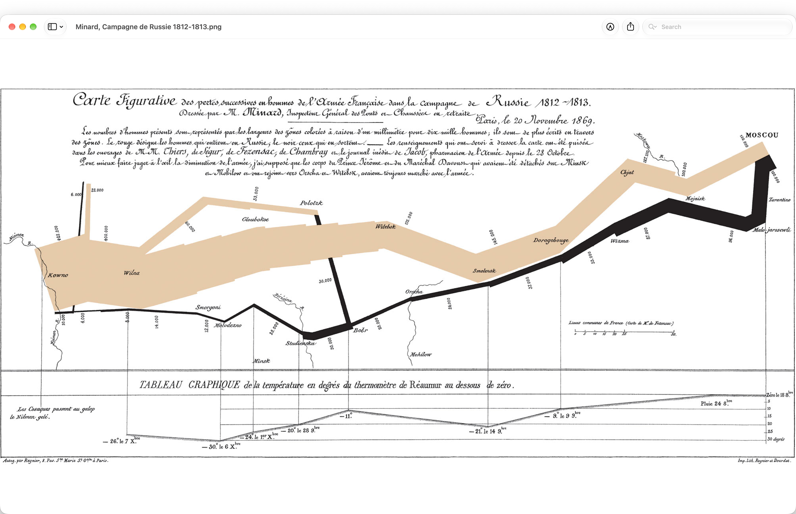

<picture><source media="(prefers-color-scheme: dark)" srcset="docs/icon-github-dark.png"></picture>

# Fully

Window maximizer for Mac. A double-click on the title bar fills the screen with the window, and the window keeps that size when dragged.

<picture><source media="(prefers-color-scheme: dark)" srcset="docs/scene.webp"></picture>

<picture><source media="(prefers-color-scheme: dark)" srcset="docs/scene-after.webp"></picture>

Apple silicon, macOS 13 or later.

## Install

```sh
brew install geragarazagh/tap/fully
```

Or download [`Fully.dmg`](https://github.com/geragarazagh/fully/releases/latest/download/Fully.dmg).
